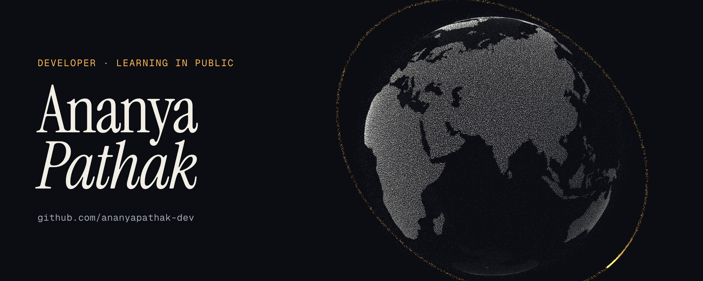
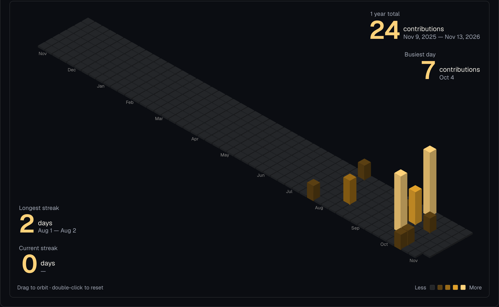

I write code in public. This page is a snapshot of my GitHub: what I've built, what I've forked to learn from, and how often I show up.

## Work

**[study-buddy](https://github.com/ananyapathak-dev/study-buddy)** — a simulated Alexa+ skill that plans exams, reschedules missed days, runs a focus timer and exports a calendar, using MCP-style tool calls. `HTML`

Also started: [batch-b1](https://github.com/ananyapathak-dev/batch-b1) · [content-snai.b1](https://github.com/ananyapathak-dev/content-snai.b1)

## Forked to learn from

| Repository | Forked from |
| --- | --- |
| [gsoc](https://github.com/ananyapathak-dev/gsoc) | [wagtail/gsoc](https://github.com/wagtail/gsoc) |
| [dev-sena](https://github.com/ananyapathak-dev/dev-sena) | [newton-priyanshu/dev-sena](https://github.com/newton-priyanshu/dev-sena) |
| [vibe-engineering](https://github.com/ananyapathak-dev/vibe-engineering) | [ash1794/vibe-engineering](https://github.com/ash1794/vibe-engineering) |
| [DevForge](https://github.com/ananyapathak-dev/DevForge) | [NST-DEVFORGE/DevForge](https://github.com/NST-DEVFORGE/DevForge) |
| [workbook](https://github.com/ananyapathak-dev/workbook) | [NST-DEVFORGE/workbook](https://github.com/NST-DEVFORGE/workbook) |
| [our-dev-wall](https://github.com/ananyapathak-dev/our-dev-wall) | [ssagar1999/our-dev-wall](https://github.com/ssagar1999/our-dev-wall) |
| [Rishiflix](https://github.com/ananyapathak-dev/Rishiflix) | [Garvit-png/Rishiflix](https://github.com/Garvit-png/Rishiflix) |

## Activity

A year of public contributions, one box per day, drawn as a skyline. Snapshot of 13 Nov 2026 — the live graph is just below.
